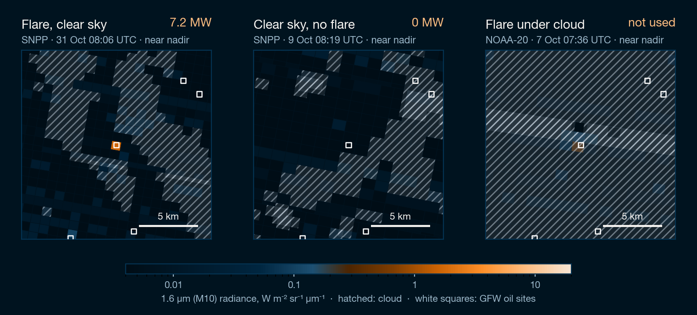
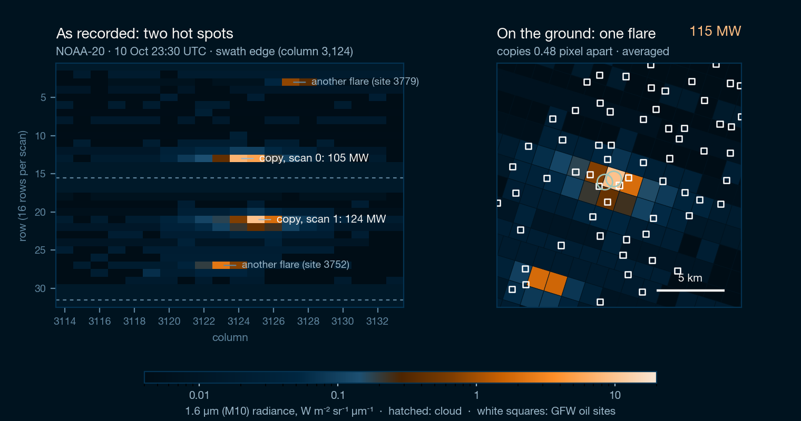
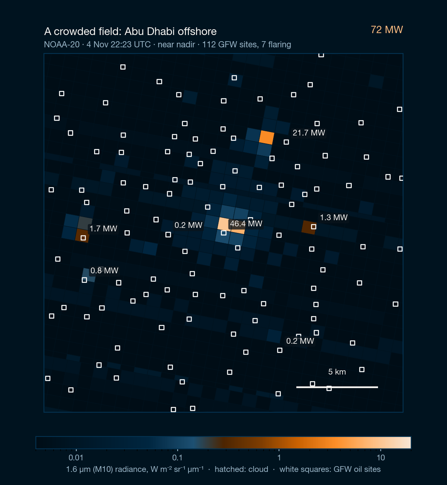
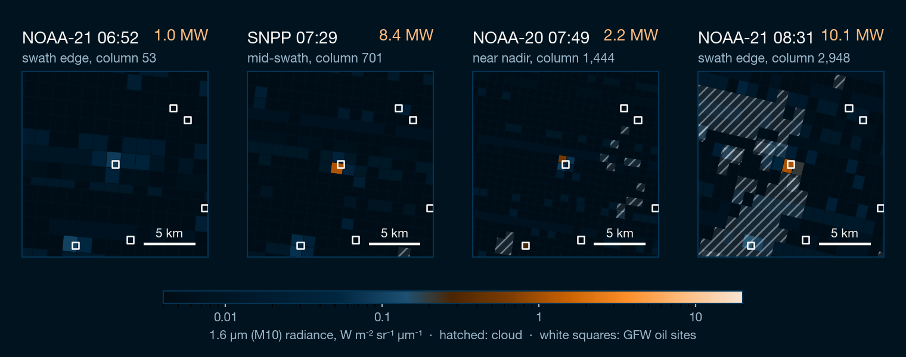
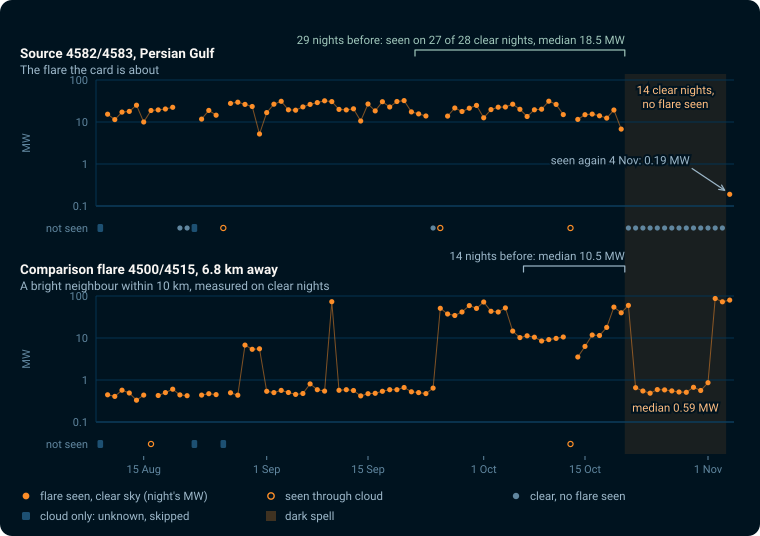
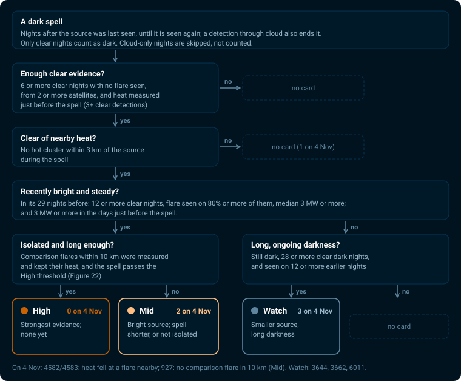
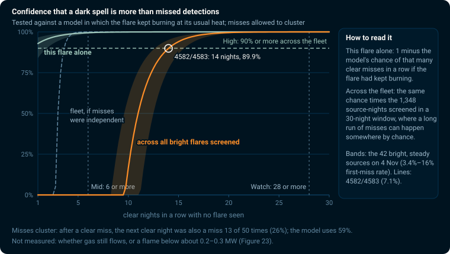
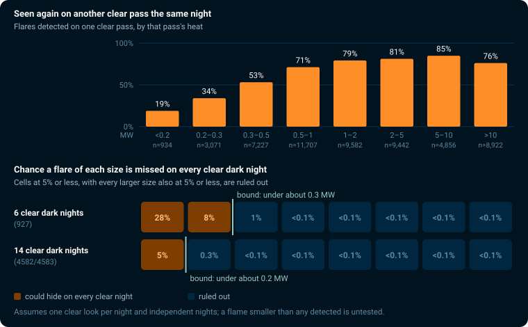
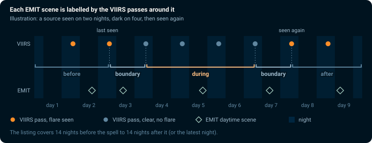
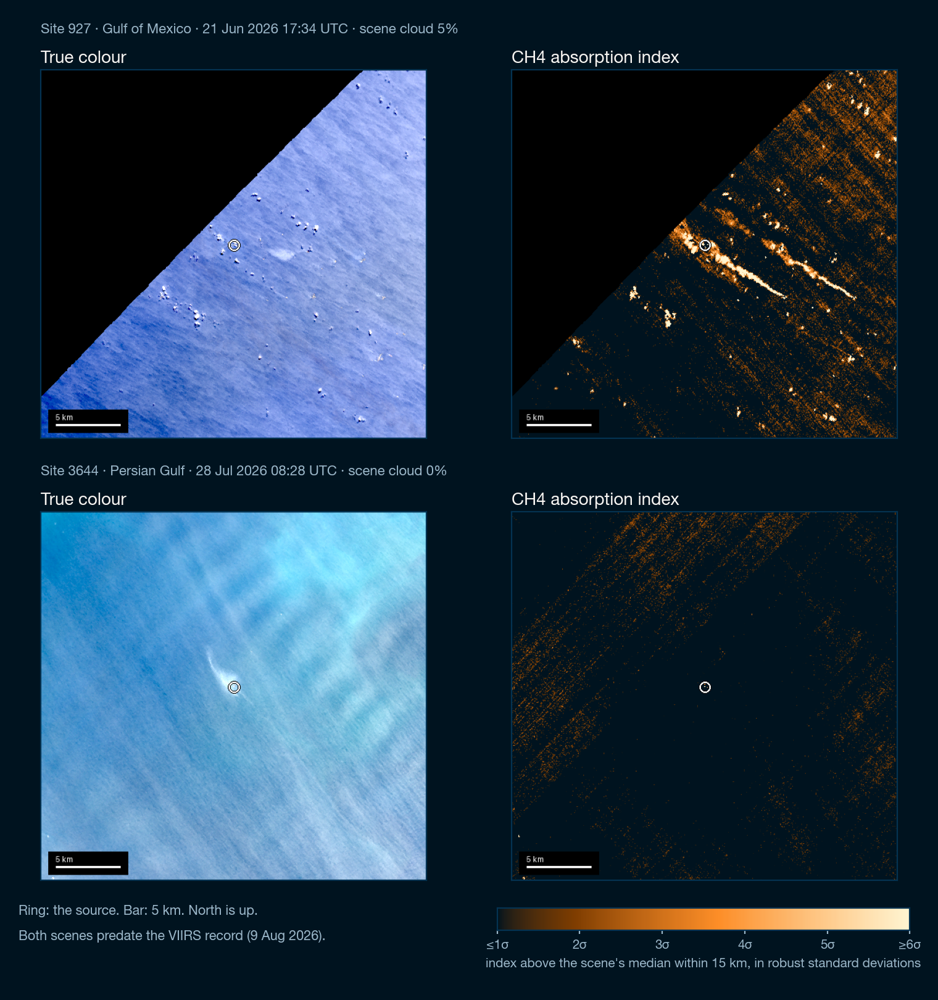

# How the nightly flaring estimates work

This pipeline estimates, night by night, how much gas is burned in flares at
7,637 offshore oil sites. It reads infrared images from three weather
satellites and follows the VIIRS Nightfire method published by the Earth
Observation Group (EOG) at the Colorado School of Mines. EOG's own nightly
data have been licensed since January 2025; this is an independent
reimplementation from their papers.

Part 1 explains the science, from a satellite image to a gas volume, and what
the numbers can and cannot tell you. Part 2 lists every place this
implementation departs from the published method, why, and how each change
moves the numbers.

Figures use all 88 nights from 9 August to 4 November 2026 (pipeline v5)
unless a caption says otherwise. Comparisons with the earlier version, v3, use
6 October to 4 November, the 30 nights run with both versions. The first
night, 9 August, is partial: NOAA had already deleted some of its satellite
files.

---

## Part 1. From a satellite image to a gas volume

*Figure 1. The six steps. Each is explained below.*

### Three satellites, one look each per night

The VIIRS instrument flies on three US weather satellites: Suomi NPP,
NOAA-20 and NOAA-21. They share one orbit, pole to pole, and cross any given
place at about the same local time: around 01:45 at night, with most passes
between 00:50 and 02:50. Each sweep covers a strip of the Earth about 3,000 km
wide, so every offshore field is seen at least once a night by each satellite.

The infrared pixels used here measure 750 m on a side directly below the
satellite (nadir) and grow to about 1.6 km at the edges of the sweep.

*Figure 2. Pixels grow toward the edges of each sweep (top). All three
satellites pass a site within the same two hours of the night (bottom).*

Clouds block the view. Over these 88 nights a site averaged 1.9 clear looks a
night, and 66% of site-nights had at least one clear pass.

### A flare is far smaller than a pixel

A gas flare is a flame a few metres across at the end of a boom. The median
flare detected here has about 2 m² of flame, which fills about 1/260,000 of a
nadir pixel. The satellite cannot see the flame's shape. It records how much
extra light the whole pixel gives off, and everything else is worked back from
that.

*Figure 3. A flare and its platform inside one pixel, to scale.*

### Why night, and why infrared

Every object glows with a spectrum set by its temperature. The night sea, at
about 290 K (17 °C), glows in the thermal infrared around 10 µm. A flare, at
about 1,750 K, glows most strongly in the short-wave infrared around 1.6 µm.
At 1.6 µm the flare outshines the sea by about 500,000 to 1, even though the
flame fills a tiny part of the pixel. In daylight, reflected sunlight would
swamp that signal, so the method works only at night.

*Figure 4. Light reaching the satellite from one pixel, split into the flare's
share and the sea's share. Shaded bars mark the six VIIRS bands used (M7 to
M13).*

### Finding the flare

In each satellite image the pipeline measures the typical brightness of the
dark sea in the 1.6 µm band (called M10) and its spread. A pixel brighter than
the average by four times the spread is a candidate. It is confirmed only when
at least one other band also shows heat; a single-band spike is usually a
particle hitting the detector.

Hot pixels that touch form a patch. A big flare also lights up its
neighbouring pixels (glow), so only the brightest pixel of a patch counts as
the flare's location.

*Figure 5. One scan line through a flare (illustration with typical values).*

### What the satellite records

These are real images of the 1.6 µm band around one platform. Each square is
one pixel, drawn at its true size and position on the sea.

*Figure 6. Three passes over site 928 in the Bay of Campeche, Mexico. Left: a
7.2 MW flare on a clear night; cloud flags nearby (hatched) do not cover the
site's pixel. Middle: a clear night with no flare; the site's pixel reads like
the sea around it, and the pass counts as zero. Right: the flare glowing
through cloud. It shows the flare was lit, but the dimmed value is not
used.*

### Reading temperature and size from the colours

A hot body's spectrum has a fixed shape for each temperature: hotter flames
peak at shorter wavelengths. The pipeline compares the brightness in up to six
bands with these shapes (Planck curves) and finds the one that fits. Two
numbers come out:

- **Temperature**, from where the curve peaks. Detected flares have a median
  of 1,747 K (5th to 95th percentile 1,488 to 2,109 K).
- **How much of the pixel the flame fills**, from the curve's height. Times
  the pixel's area, this is the flame's area in square metres.

A band that disagrees strongly with the others is set aside and the fit
repeated.

*Figure 7. A real measurement: NOAA-20 over site 3802 on 10 October 2026. Five
bands agree on a 1,699 K flame; M7 is set aside.*

### Radiant heat

Temperature and area give the heat the flame radiates, by the
Stefan–Boltzmann law: heat = area × σ × temperature⁴. The result is in
megawatts (MW). The median detection is 1.19 MW, and 95% are below 29 MW.

A flare that spills into neighbouring pixels gets their heat added, counting
only neighbours that read at least 75% of the peak pixel. EOG calls this value
RH75%.

*Figure 8. The radiant-heat formula and typical values over 34,087
detections.*

### One flare, recorded once, at one site

Bow-tie copies and neighbouring platforms can each make one flare look like two.

**Bow-tie copies.** VIIRS sweeps 16 rows of detectors at a time. Toward the
edges of the swath each sweep widens and overlaps the next, so a flare can be
recorded twice, about a pixel apart, in consecutive sweeps. The pipeline pairs
such copies and averages them into one measurement.

*Figure 9. Consecutive scans overlap toward the edges of the swath.*

*Figure 10. A real pair at the swath edge: NOAA-20 over site 3802, off Saudi
Arabia, 10 October, the pass whose spectrum is in Figure 7. As recorded (left), the flare appears in two scans, eight
rows apart, at 105 and 124 MW. On the ground (right) the two copies land 0.48
pixel apart, and the pipeline averages them to 115 MW. The flare at the top of
the strip belongs to site 3779; its other copy is in the previous image.*

**Neighbouring platforms.** Half of the sites (3,858 of 7,637) have another
site within 2 km, while an edge pixel is 1.6 km wide. A flare's glow can light
the pixel over a neighbour. The pipeline treats a hot patch as one source and
assigns it to the site nearest its centre, within 2 km.

*Figure 11. The same hot patch, counted pixel by pixel (left) and as one
source (right).*

*Figure 12. NOAA-20 over a field off Abu Dhabi, 4 November: 112 GFW sites in
a 22 km square, seven of them flaring on this pass, 72 MW in total. Each hot
patch is given to the nearest site; the other sites read zero for this
pass.*

### From passes to nights to a yearly rate

Each satellite pass over a site gives one of four outcomes:

- **Flare seen, clear sky**: a radiant heat value.
- **Clear sky, no flare seen**: counts as zero. A flare that is off, or too
  small to detect, contributes nothing.
- **Flare seen through cloud**: proof the flare was lit, but the cloud dims
  it, so the value is not used for volume. The app shows these nights as
  "lit under cloud".
- **Cloudy, nothing seen**: unknown. It is left out entirely, not counted as
  zero.

A night's value is the mean over its clear passes. A longer period's value is
the mean over nights that had a clear pass.

*Figure 13. Every pass over site 928 (Bay of Campeche, Mexico) for 88 nights.
Hover a dot in the app to see its value.*

### Converting heat into gas

EOG calibrated radiant heat against gas volume using flares with metered flow:
36 controlled tests at the John Zink flare test facility in Oklahoma (Zhizhin
et al. 2025) and national flaring reports (Elvidge et al. 2016). Their
2025 annual catalog uses:

**gas flared (billion m³ per year) = 0.0116 × mean radiant heat (MW)**

A site averaging 1 MW over the year flares about 11.6 million m³ of gas a
year. The result is an annual rate: what the site would flare in a year if it
kept the average seen over the nights observed.

*Figure 14. The conversion scale, with the 651 sites seen flaring on clear
nights. The median flaring site averages 0.14 MW, about 1.7 million m³ a
year.*

### What the numbers can and cannot tell you

**Small flares are missed.** The detection limit depends on the sensor, not
the flare. Detections thin out below about 0.3 MW, and small flares are missed more so at the edge of
the swath where pixels are larger. A site reading "clear, no flare" may still
have a small flame.

*Figure 15. Radiant heat of every detection. The drop below about 0.3 MW comes
from the sensor's limit.*

**One pass is a sample.** Flames flicker and wind bends them, and the
satellites see a site minutes apart from different angles. When two
satellites both saw the same flare on the same clear night, 30% of the pairs
differed by more than a factor of two (n = 4,961 site-nights). Averages over
weeks are much steadier than any single night.

*Figure 16. NOAA-20 against NOAA-21 for the same site and night.*

*Figure 17. Four passes over site 928 on the night of 1 November, 100
minutes apart from first to last. Edge pixels (first and last panels) are
about twice as wide as nadir pixels. The flare reads between 1.0 and 10.1 MW;
at column 53 its light is spread over one large pixel and barely clears the
background. The night's value is the mean of the four.*

**Viewing angle changes the reading.** Flames are taller than they are wide,
so a satellite looking from the side sees more flame than one looking
straight down. Passes near the swath edge read 1.58 times the nadir passes at
the same flares (median of 39 persistent flares seen on at least 80% of clear
passes from both angles). EOG's calibration does not
correct for this, and neither does this pipeline; it averages out over many
passes.

*Figure 18. Apparent flame area against viewing angle, for flames 1, 1.6 and 2
times taller than wide (Elvidge et al. 2016).*

**Clouds hide flares.** Cloudy passes are left out, so a site under cloud for
a week has no value for that week. Thin cloud that the cloud mask misses can
dim a flare without removing it.

**One time of night.** All passes fall between about 00:50 and 02:50 local
time. A flare that runs only by day, or changes through the day, is sampled
at that hour only.

**Nearby platforms are hard to tell apart.** Where two GFW sites sit within
2 km of one known flare, the flare is assigned to one site on some passes and
the other on other passes in 64% of cases (126 of 197 such flares). Totals over
an area are more reliable than the split between neighbouring platforms.

**Not every flare is from oil production.** The site list is GFW's offshore
oil infrastructure. Some sites are processing plants or terminals, which this
pipeline does not yet flag.

**The calibration is an average.** The 0.0116 slope comes from controlled
tests and national totals; the 2025 calibration paper's text gives 0.0124,
7% higher. Individual flares burn gas of different composition and
efficiency.

**Agreement with EOG.** At 429 sites flaring in both this pipeline (88 nights
of 2026) and EOG's 2025 annual catalog, the two agree in order of magnitude
and rank (correlation of the logs r = 0.59) and our values are lower (median
ratio 0.68). The comparison mixes different years, period lengths and site
lists.

*Figure 19. Each dot is one site, matched to the nearest EOG flare within
2 km.*

**The record starts in August 2026.** The free NOAA data bucket keeps about 91
days. Earlier years exist in NASA's archive, which uses a different file
format and calibration and is not yet read by this pipeline.

### Potential flare-outs

When a flare that usually burns shows no flare on a clear night, there are
four possible causes:

1. **The sensor missed a burning flare.**
2. **Thin cloud hid it**, and the cloud mask called the sky clear.
3. **The flame was turned down** below the detection limit.
4. **The flare was out.** Gas then either stopped flowing to it or was sent
   elsewhere (a shutdown, maintenance or gas recovery), or kept flowing
   unburned (venting). Gas can still escape from other equipment during a
   shutdown; the flare record says nothing about that.

The satellite record cannot tell these apart on one night. Over a run of clear
nights, repeated sensor misses become unlikely (Figure 22); the other causes
remain possible, and the record cannot separate the two cases in the fourth.

A card in **Flare-outs** means that a source has been dark for several clear
nights after a period when we could see its heat. It is a place to inspect,
not evidence that gas is escaping.

One missed pass tells us little. Clouds hide flares, small flames are missed,
and the same source can be assigned to different nearby platforms. The screen
therefore follows the location of the heat, joins overlapping platform records,
and counts a dark night only when there was a clear view. A detection through
cloud still ends the spell. A card needs clear misses from at least two
satellites. The search covers the hot clusters sampled near GFW sites; it is
not a complete search of the surrounding sea.

We compare each source with its own **29 nights immediately before the dark
spell**. A source that becomes bright later can enter the screen.

We also date changes in a flare's heat. Take a flare that burned at 50 MW for
weeks, was turned down to 8 MW for a few nights, and then went dark. Its card
gives **8 MW** as the heat before darkness: the median of its clear detections
in the last week before the spell, counting only nights at that latest level.
That is the flame that disappeared, so 50 MW would overstate what went missing.
It must be 3 MW or more for the flare to count as recently bright. The drop
from 50 MW to 8 MW is listed separately, with its dates, in the card's heat
history.

*Figure 20. The Mid card 4582/4583 in the Persian Gulf. Top: in the 29 nights
before its spell the flare was seen on 27 of 28 clear nights (median 18.5 MW);
then no flare on 14 clear nights from 21 October to 3 November; then 0.19 MW
on 4 November. Bottom: the nearest bright comparison flare, 6.8 km away, fell
from a median of 10.5 MW to 0.59 MW over the same nights, so the card reads
"heat also fell nearby".*

| Tier | What the card means | Clear dark nights needed |
| --- | --- | --- |
| **High** | A recently bright flare has an unusually long clear dark spell under the conservative model, and measured nearby comparison flares show no sustained heat loss. | Enough to pass the High threshold: 13 to 16 for the bright sources on 4 November (Figure 22) |
| **Mid** | A recently bright flare has at least six clear nights with no flare seen, but the spell is shorter, nearby heat also fell, or comparison coverage cannot resolve isolation. | 6 |
| **Watch** | A smaller or less reliable source has a long clear dark spell, with enough earlier detections to make review useful. | 28, with the spell still ongoing |

*Figure 21. The rules a dark spell must pass to become a card. Counts are for
4 November.*

**Clear nights are not calendar days.** Cloud-only nights are skipped. At the
median bright site (31 sites whose median nightly heat was 3 MW or more over
88 nights), 88%
of nights had at least one clear pass; at the cloudiest tenth of those sites,
26%. Fifteen clear dark nights take about 17 calendar nights at the first and
about 58 at the second.

#### How long real flares stay out

**A flare can go out for minutes or for weeks.** Flare pilots carry flame
detectors and relight automatically when the flame is lost, so many flame-outs
last minutes ([John Zink](https://www.johnzink.com/resources-training/knowledge-hub/ensuring-flare-pilot-reliability-preventing-and-mitigating-fuel-supply-failures)).
Longer outages follow a failed ignition system, lost pilot gas, or work on the
flare tip. At the Zaap-C platform in the Bay of Campeche, about 7 km
east-southeast of site 927, the flare was reported unlit for 17 days in
December 2021 while the platform vented about 40,000 t of methane
(Irakulis-Loitxate et al. 2022). In US onshore basins, aerial surveys found
3–5% of flares unlit at any one time (Plant et al. 2022), and in repeat
Permian surveys over one week in 2020 more than half of the malfunctioning
flares were unlit or partly lit on more than one day ([EDF](https://www.edf.org/media/helicopter-surveys-indicate-malfunctioning-flares-permian-basin-are-releasing-least-300000)).
No published record gives the spread of outage durations offshore. A flare can
also go dark because gas stopped flowing to it or was sent elsewhere; that
puts no gas through the flare, but says nothing about the rest of the
platform.

**VIIRS looks for about two hours a night.** Passes fall between about 00:50
and 02:50 local time. An outage that starts and ends between passes leaves no
record, and a flare relit the next day ends the spell on the next detection.

**Single dark nights happen at steady flares, for unknown reasons.** At bright
flares seen on at least 80% of clear nights (115 stable 29-night blocks), a
clear night with no detection followed a detected night 1.7% of the time (43 of
2,568). Nothing in the record says whether the flame was burning on those
nights: any of the four causes above, including an outage of under a day, can
produce one. The misses do not gather where the sensor is weakest: of all 56
clear nights without a detection in those blocks (the 43 after a detected night
and 13 after another miss), 42 had a clear pass near the centre of the swath
and 46 had three or more clear passes. Of the 50 with a following clear night,
37 were followed by a detection, so most are single nights. The screen treats every one of these misses as a missed
detection of a burning flare. That assumption makes darkness easier to explain
away, so it lowers the confidence numbers below; any real short outages among
them would raise them.

**Each source gets its own miss rate.** A source's rate is its own count of
misses after detected nights in its 29 nights before, with one hit and one
miss added so that a source never missed is not treated as never missing. On
4 November the 42 bright, steady sources ranged from 3.4% to 16%; the 3.4% low
end belongs to sources with no misses at all and is the added count alone.

**Confidence grows with each clear dark night.** If a bright flare kept
burning at its usual heat, a long run of clear misses would be rare. For
4582/4583 (one miss in 26 clear nights that followed a detection, rate 7.1%),
the confidence that
its darkness is more than chance misses is 92.9% after one clear night, 99.5%
after six and 99.99% after fourteen. The screen, though, watches every bright source every
night: 1,348 source-nights in that spell's 30-night window. A long run of
misses can happen somewhere by chance, so the fleet-wide confidence stays at
0% through nine nights, then reaches 17% at 10, 51% at 11, 83% at 13, 89.9% at
14 and 94% at 15. High requires 90% across the fleet.

*Figure 22. Confidence that a dark spell is more than missed detections, by
clear nights in a row with no flare seen. "This flare alone" is 1 minus the
model's chance of that many clear misses in a row if the flare had kept
burning at its usual heat; "across all bright flares screened" multiplies that
chance by the number of source-nights screened. The model's miss rates come
from single dark nights at steady flares, counted as missed detections even
though some may be real short outages. Bands span the 42 bright, steady
sources on 4 November; lines use 4582/4583. Watch sources fail the bright rule
and are not scored on these curves. These are model sensitivities, not
validated rates. They say nothing about why the flame stopped: a shut-in
with no gas flow and an unlit flare venting gas leave the same record.*

The conservative model allows missed detections to cluster. After a clear
miss, the next clear night at steady bright flares was also a miss 26% of the
time (13 of 50; 95% upper bound 40%); the model uses 59%. If misses were
independent, four clear dark nights would pass the High threshold instead of
13 to 16. The High threshold counts eligible sources in **each spell's own
30-night fleet window**, which always contains the spell's start. For an ended
spell, the window ends at its last dark night and stays fixed on later builds.
For an ongoing spell, it ends at the as-of night. Once either spell exceeds 30
nights, its window stays on its **first 30 nights**. During startup only
available evaluation nights count; the family has a conservative floor of one
tested unit per available night (at most 30). Adding older months or moving
the calendar forward cannot move an ended spell's window; new thermal evidence
can change eligibility or model calibration. Mid is a direct evidence rule and
does not rely on treating successive nights as independent. The exact rules and
arithmetic are in
[D58](decisions.md#d58-source-centred-flare-out-evidence-cards-and-tiers-v5).

**We also compare heat at nearby flares.** A comparison flare must
have measured clear heat on at least three of the **14 nights before the
spell**, with median heat **at least 3 MW**. We compare
only nights when their heat was measured or when a clear view found no flare;
cloud-only detections leave heat unknown. For example, 4500 continued to be
detected while its heat fell sharply during the 4582/4583 spell (Figure 20,
bottom). That makes a shared operating change a plausible explanation, without
proving a shared cause. No comparison flare within 10 km means that isolation
is unknown, and caps the card at Mid.

Each card shows the earlier heat in megawatts (MW) and a **conditional heat
bound** during darkness. This asks whether a flame like those we have detected
in a particular heat range would plausibly have escaped every clear night.
It depends on that observed sample and on independent nights; it is not a
physical upper limit. A flame smaller than any detected remains untested.

*Figure 23. Top: of flares detected on one clear pass, the share detected again
on another clear pass the same night, by heat. Bottom: the chance that a flare
of each size is missed on all 6 (927) or 14 (4582/4583) clear dark nights.
The bound starts at the smallest size that, with every larger size, falls to
5% or less.*

**EMIT adds daytime review opportunities.** For every card, a table lists
scenes covering the source before, during, between the bracketing VIIRS
passes ("boundary"), or after the spell. Scene cloud cover does not tell us
whether the source itself was clear. A covering scene is not a methane finding.

*Figure 24. Labels follow the VIIRS passes, not calendar dates. A scene between
the last pass that saw the flare and the first clear miss is "boundary",
because the flare may have stopped at any time in between.*

When imagery is available, the card pairs true colour with a quick-look CH4
absorption index. The index highlights relative absorption in two spectral
ranges; it is **not a calibrated methane concentration or emission rate**.
Water, clouds and surface spectra can produce signal. For scenes newer than
Earth Engine's measured EMIT collection cutoff, the card shows that date and
"not in Earth Engine yet". If the cutoff cannot be measured, availability
remains unknown. The pipeline retries
each build and retains cached images during offline rebuilds. No plume has
been confirmed by this screen.

*Figure 25. EMIT review images as the Flare-outs tab draws them, from scenes
before Earth Engine's 31 August cutoff and before the VIIRS record. Top: site
927, 21 June 2026. A narrow band of high index values joins the marked source
to a point about 7 km east-southeast, near the Zaap-C platform; a parallel band
lies about 4–5 km to the east. Both bands narrow toward their east-southeast
ends. The image alone does not show which end the gas came from, or that it is
methane. Bottom: site 3644, 28 July 2026. A pale streak beside the source in
true colour has no counterpart in the index; diagonal bands of weak index
values cross the chip. NASA's public EMIT plume list ends on 22 September 2025
and covers neither date.*

The record cannot show whether production continued, whether a stop was
planned, whether a flame is out, or whether gas is vented. The
[research brief](flareout_research/BRIEF.md) and six round memos preserve the
reasoning and unresolved limits.

### Single dark nights

In **Flare-outs → Single dark nights**, each row is a **dark run** at a source:
one or more clear nights when no source copy was detected within 1.5 km. Any
detection, including one through cloud, ends the run. Cloud-only and unobserved
nights do not split it. The row shows the run's dates, its clear dark nights,
how many nights qualify for this list, and the best qualifying night's burning
rate, recent heat and clear-pass count. Open it to see each qualifying night's
own measurements and passes.

A night qualifies when the flare was seen on **more than half of at least 10
clear nights** within 14 nights before or after it. Leave out only the selected
night and any nights with only a neighbouring source's detections; the run's
other clear dark nights count as unlit. For this rate, a detection must be
within 1 km or nearest this source unit. Neighbour-only nights within 1.5 km
are neither lit nor dark for the rate, so both counts leave them out and the
detail shows how many were excluded. The darkness rule still uses 1.5 km. A
dark night is also left out when another source within 1.5 km was detected that
night: its detections can land just beyond 1.5 km, and the record cannot tell
which of the two was burning. At least one lit clear
night must precede the run inside that window. This keeps a source that has not
yet been seen burning from being read as one that went dark. A night with fewer
than 14 later processed nights is **provisional**: its rate can change next
month. Every burning rate shows lit/clear counts. Recent heat is the median
measured heat on lit clear nights in the same window, with n nights measured.
Unmeasured heat stays in the list.

Most single dark nights at steady flares are unexplained. In the D61 sample,
**1.7% (43/2,568)** of clear nights that followed a detected night had no
detection, at flares seen on **at least 80% of clear nights** in **115 stable
29-night blocks**. Those 2,568 following clear nights are the denominator;
they are not all clear nights in the record. The observations do not tell us
which of the four causes under Potential flare-outs explains a dark night.

**Most surprising** puts nights first when a cautious estimate of how often
the flare is seen is high and a flare of its recent heat is usually seen across
that night's clear passes. It multiplies the 95% Wilson lower bound of the
lit/clear share by `1 − (1 − p)^k`, where p is the heat class's same-night
re-detection rate and k is the clear-pass count. The detail shows both parts
with their counts. A run uses its best night's score; ties use higher recent
heat. **Brightest** and **Most recent** are also available. Passes on one night
are not independent, so this is a review order, not a probability.

The heat strip covers the run and 14 nights on either side. Clear dark nights
are zero, lit nights without measured heat have hollow diamonds, nights when
only a neighbouring source was detected have a cross (they are left out of the
burning rate), and unknown nights have gaps. The band says **dark run**. When recent heat is measured,
the axis stops at three times that heat; triangles mark higher values, which
remain available by hovering. A note links another listed source within 1.5 km
when its run shares a clear dark night: the detection apertures overlap.

EMIT scenes cover two local nights before the run through two nights after.
**Before**, **during**, **boundary** and **after** follow the last lit, first
and last clear dark, and next lit VIIRS passes. A daytime scene beside a single
dark night is usually **boundary**. Signed hours are measured from the nearest
clear dark pass in the run. The bracket, scenes, comparison scenes and card
link appear once per run; each qualifying night's measurements are stacked
below. Pass times are short UTC times, with their dates above the table.

Up to three **comparison scenes · lit on both sides** show the source when the
nearest VIIRS passes before and after both detected it. They exclude every
listed run's two-night scene window at that source. The closest remaining
scenes to the dark passes come first. Comparisons also need measured EMIT data
under the source marker; missing or unknown coverage cannot be a comparison.
CMR listings keep monthly caches; a month becomes final when fetched at least
30 days after its end. All non-final months share one query per product per
source, so a rebuild uses at most two ordinary requests per source (large
results may need more pages). Builds try at most
60 new scene renders, sharing successful cached chips. Half the budget, rounded
up, is reserved for scenes never tried before. Failed renders retry after 1,
2, 4, 8, 16, then 32 days, so one failure cannot hold up the list. Scenes beyond
the measured Earth Engine collection end stay pending even with no render
budget. Other scenes wait for a later build.

An EMIT footprint can include a gap between image strips. Both modes check
the index mask under the source marker and count valid pixels within 300 m.
**No EMIT data at the source in this scene (it falls between image strips)**
keeps its browse link and is not counted as with-chips. Unknown coverage is
also left out. Old cached chips are checked offline; missing or unreadable
files remain unknown. Same-orbit tiles taken within 30 seconds count as one
acquisition: use the tile covering the source and note an adjacent empty tile.
New chips use grey for missing data, inside and outside the scene, and dark
blue for index values ≤1σ; both captions say so. The new recipe refreshes older covered chips when available,
while a known empty source needs no repeat render. Card rules stay unchanged.

A dark night does not show why a flare was unseen. EMIT scenes are daytime,
hours from the VIIRS passes. The CH4 index is not a concentration. Scene cloud
cover describes the whole scene, not cloud at the source. Missing listings
leave coverage unknown. One compact file loads when the mode opens; it keeps
source locations, nearby heat history and scene records once, with no full
pass histories. The exact rules are in
[D62](decisions.md#d62-single-dark-nights-and-emit-comparison-scenes-v5).

### Reading the app

Use **Map** for nightly flaring, **How it works** for the method, and
**Flare-outs** for ranked High, Mid and Watch evidence cards. Select a row or locator-map dot for
its heat chart, comparison flares, satellite passes and EMIT review material;
**Show on map** selects its site. The shaded chart interval is the dark spell.

- **Map colour** is the site's mean radiant heat over the selected nights.
  Gas volume in the side panel uses the 0.0116 conversion.
- **The timeline.** Each bar is the radiant heat summed over every site seen
  flaring that night. The band beneath it shows the share of all sites seen in
  clear sky that night, lighter where clearer: a low bar over a dark band
  means cloud, not less flaring. The tooltip flags partial nights, when
  satellite files are missing at either end of the record. Click a night,
  drag across bars to average a range, or pick Last 7, Last 30 or All; Last 90
  appears once the record passes 90 nights. The ← and → keys step one night.
- **Ordering the flare list.**
    - *Strongest*: mean clear-sky radiant heat over the selected nights, with
      clear nights showing no flare counted as zero. In single-night mode,
      that night's value.
    - *Most consistent*: the share of clear nights with a flare. Sites are
      ranked by the low end of that share's 95% range, so a site flaring on 4
      of 4 clear nights ranks below one flaring on 40 of 44.
    - *Most clear views*: the number of satellite passes that saw the site
      through clear sky in the selected nights. More clear views give a
      steadier average.
- **The radiant-heat filter** above the list keeps only flares whose mean
  radiant heat over the selected nights is at or above the chosen percentile.
  It ranks by heat alone, whatever order the list uses, and the same flares
  stay shown on single nights and during playback. A site you have opened
  always stays on the map, with a dashed ring on nights no satellite passed
  over it.
- **Small charts**, beside each flare, in the map tooltip and in the site
  panel, have one column per night. A column's height is that night's clear-sky
  radiant heat, relative to the site's highest night. A strip along the bottom
  gives each night's status: light orange flaring, dark orange lit through
  cloud, blue-grey clear with no flare, dark blue cloudy, and a gap where no
  satellite passed.
- **Site detail.** Clicking a site centres the map on it and shows every
  night as an overview, with a
  14-night window you can drag. Below it is each satellite pass in the window:
  a filled orange dot is a detection in clear sky, an orange ring a detection
  through cloud (not used for volume), a blue ring a clear pass with no
  detection, and a cross a cloudy pass.
- **A single night** is a sample of one to three passes. Use ranges of a week
  or more to compare sites.
- **"Lit under cloud"** means the flare was seen through cloud. It shows the
  flare was burning but carries no volume.
- **Regional totals** are steadier than the split between neighbouring
  platforms.

---

## Part 2. What this implementation changes

EOG describes VIIRS Nightfire across nine papers from 2013 to 2026 but has not
released its code, and several settings are not published. This pipeline
rebuilds the method from the papers. The changes fall into five groups:
scope, simplifications, settings the papers leave open, corrections added
here, and reliability work that does not change values.

Each version was reviewed by two independent AI models (GPT-6.1 Sol and Claude
Opus 5.5) against the papers and the run outputs; five reviews so far.
Every choice, with its evidence, is in the
[decision log](decisions.md) (entries D01 to D52), and every review finding is
in the [review record](reviews.md).

### Net effect of the corrections

The corrections in group D below were made between pipeline v3 and v5. Over
the 30 nights run with both versions (6 October to 4 November 2026) they cut
detected radiant heat by 20%, while the number of detections fell by only
1.4% (11,695 to 11,527). The summed site means fell from 944 to 759 MW, or
from 10.95 to 8.80 billion m³ a year. 81% of the drop
removes errors in v3's handling.

*Figure 26. Radiant heat summed over all detections, v3 to v5, by cause,
over the 30 nights run with both versions.*

### A. Scope: where and when we look

**Only GFW offshore oil sites.** EOG detects flares anywhere and builds its
own catalog of flare sites. This pipeline looks only within 2 km of Global
Fishing Watch's offshore oil infrastructure: 11,342 active structures, merged
into 7,637 sites where they sit within 750 m of each other (about one pixel).
*Why:* the goal is a value per platform. *Effect on interpretation:* a flare
more than 2 km from any listed structure is not counted, and totals cover
GFW-listed infrastructure only. 215 of our flaring sites have no EOG flare
within 2 km.

**Nightly values from NOAA's free bucket.** EOG publishes annual values
openly and licenses nightly ones. This pipeline reads the same raw satellite
files (NOAA's operational sensor data records) from NOAA's free public
bucket. *Effect:* nightly values with no licence, but only for the last 91
days; history needs another data source.

**Only the images that contain a site.** NASA's catalog of image outlines
selects the roughly 150 of 500 night images per satellite that contain a
site. *Effect:* none on values; it cuts download time about threefold.

### B. Simplifications

These published steps are not reproduced:

| EOG step | Here | Effect on interpretation |
| --- | --- | --- |
| Spectral response of each band | Planck curve evaluated at the band centre | A few percent of model error (decision D12), covered by the 10% allowance in group C |
| Two-curve fit (flame plus warm background) | One flame curve; mid-infrared bands have the local background subtracted first | Not compared directly |
| Triggers from M11 and from the mid-infrared bands | Detection starts from M10 only | The faintest and coolest flares are missed: 12% (41 of 356) of EOG's persistent flares had no clear-night detection in 88 nights |
| Atmospheric correction (VIIRS Nightfire v4) | None | Matches the v3 top-of-atmosphere values the 0.0116 slope was calibrated on |
| Cross-calibration between satellites | None | Satellite differences enter the average unadjusted: NOAA-20 reads 0.95 times NOAA-21 at the same flares (median, n = 4,961) |
| Day/Night Band, for flares seen only at 1.6 µm | Not used; a candidate needs a second infrared band | Such single-band candidates are dropped: 1 of 93 candidates near sites in a five-image check |

### C. Settings the papers leave open

The papers describe these steps without a number. Each value here is a choice,
recorded with its reasons:

| Setting | Choice | Why |
| --- | --- | --- |
| How the fit weighs each band | By each band's measured noise, plus a 10% allowance for model error | Without the allowance, every flare above 20 MW failed the fit test on model error alone and lost bands |
| Glow test neighbourhood | Peak must be the brightest pixel within 2 pixels in its scan | The papers give no size |
| Small isolated clouds over a flare | Cleared when 6 of the 8 surrounding pixels are clear | EOG clears isolated clouds over flares but gives no size |
| Which neighbours join RH75% | The 8 pixels touching the peak in its scan, between 0.75 and 1.5 times the peak | The papers say "adjacent pixels" without a stencil or cap |
| Repeated records of one site | Same satellite, under 10 s apart: one observation | Neighbouring images overlap by a few seconds |
| Background statistics | Per image and per pixel-size zone, with one clipping pass | The papers' screen is in raw sensor counts; these files hold calibrated radiance |

### D. Corrections and safeguards added here

**1. The site's pixel must hold a measurement.** Where bow-tie copies overlap,
NOAA blanks the duplicate pixels but keeps their positions. The first version
of this pipeline read such blanks as "clear sky, no flare" at 11% of site
passes (21,205 of 189,764). The pipeline now uses the nearest pixel with a
real measurement. *Effect:* removes false zeros that pulled site means down.

**2. One flare, one site.** Reading pixel by pixel, the first version counted a
large flare's glow as a second flare at the neighbouring platform: 12.7% of
detections (501 of 3,935). The pipeline now groups hot pixels into one
source, applies the glow test, and assigns the source to one site by its
centre. *Effect:* glow detections fell below 1%. Over the 30 nights run with
both versions, the source-centre assignment removed a further 3,783 MW of
double counting, and same-pass detections at two sites under 2 km apart fell
from 196 (v3) to 72 pairs (v5) (Figure 11).

**3. Physical limits on the temperature fit.** A fit that uses only the two
shortest bands (M7 and M8) can match them with a cool, very large "flame",
which inflates radiant heat many times over. The pipeline now requires at
least two of the four flare bands (M10 to M13), including M10 or M11, and a
temperature of 1,200 to 3,500 K (two-band fits 1,200 to 2,500 K). A good fit
that breaks a limit is replaced by a standard 1,810 K estimate from M10,
instead of dropping bands until the limit passes. *Effect:* over the 30
nights run with both versions, removed 5,917 MW (7.7% of v3's detected heat)
from 330 detections. At site 3802 one pass fell from 3,127 MW to 115 MW. Over
all 88 nights, fits replaced by the standard estimate are 3.0% of detections
and 0.3% of radiant heat.

*Figure 27. Site 3802: the v3 fit (dashed) matches M7 and M8 but overshoots
every other band; the corrected fit (solid) matches five bands.*

**4. Radiant heat anchored on the flare's peak.** EOG's RH75% adds pixels
above 75% of the patch's highest-heat pixel. One badly fitted pixel can then
set the whole value. The pipeline anchors on the brightest 1.6 µm pixel,
which locates the flare, and adds only its touching neighbours. *Effect:*
over the 30 nights run with both versions, removed 3,010 MW over 200
detections; site 3804 on 3 November fell from
1,776 MW to 71 MW.

*Figure 28. The same hot patch under the old and new rule.*

**5. Bow-tie copies matched and averaged.** EOG drops copies closer than half
a pixel and keeps one. Here, 61% of matched copy pairs (2,282 of 3,757) sit
more than half a pixel apart, so the half-pixel rule would count them as second
flares. The pipeline pairs copies in consecutive sweeps up to 1.5 pixels
apart, in the same column (±1), within a factor of 3 in heat, one copy per
sweep; averages their heat; and places the flare at their heat-weighted
centre. *Effect:* 3,757 copy pairs merged over 88 nights. Over the 30 nights
run with both versions, averaging gives 1,981 MW less than keeping the
stronger copy; keeping the stronger copy, as EOG does, would make the
v3-to-v5 change −18.0% instead of −19.9%. Read our
totals as about 3% below an EOG-style count.

**6. Two flares in one hot patch.** Flares on one platform can merge into one
hot patch. The pipeline splits a patch at a second brightness peak only when
the brightness between the two peaks drops below half of the smaller peak.
*Effect:* 0.87% of detections (298 of 34,087) come from split patches. Of the
75 detections new in v5 over the 30 nights run with both versions, 8 of the
10 largest come from split patches.

**7. Clear-sky rule kept strict.** The first version counted every detection
as clear sky. 30% of its detections were under cloud flags, carrying 18% of
the heat. The pipeline now uses only clear passes for volume and shows
cloud-covered detections as "lit under cloud". *Effect:* volumes are
clear-sky averages; the on/off record still uses the cloudy detections.

**8. Detections kept when images overlap.** When a site appears in two
consecutive images seconds apart, the pipeline keeps the record with a
detection, if either has one. *Effect:* none of the 34,242 observations with
a detection was lost over 88 nights.

**9. Viewing angle measured, not corrected.** Section "Viewing angle" above.
Edge passes read 1.58 times nadir passes (n = 39 flares). Elvidge et al. 2016
corrected flame area to a side view; the operational calibration and this
pipeline do not. *Effect:* single-night values depend on which satellite
looked from where; averages over many passes mix geometries the same way
EOG's do.

**10. Like-for-like comparison with EOG.** EOG reports how often a flare is
detected per clear pass. Measured the way EOG counts, detections per clear
pass at persistent flares are 0.38 here (strict clear sky, n = 356) or 0.47
(counting a detection as proof of clear sky), against EOG's 0.63. *Effect:*
the published per-site rate (0.27 in v3) understated detection. Review 2
split v3's gap into roughly equal parts: cloud handling, attribution among
nearby sites, and small flares plus real change between 2025 and 2026.

### E. Reliability and audit trail

These changes do not alter values:

- **Copy table.** Every confirmed flare copy is saved with its position, fit,
  cloud flag, pairing and site, so attribution can be re-checked without
  downloading the images again.
- **Restartable runs.** Each image's results are written atomically and a
  manifest lists every expected image, so an interrupted run resumes where it
  stopped and missing images are listed.
- **Oldest images first.** NOAA deletes the oldest nights first, so long runs
  process them first.
- **Retries and caching** for NASA's catalog, which took up to 84 s per query
  during the 30-night run.
- **Gate checks.** A script tests every run against eleven acceptance gates
  (coverage, fit limits, copy pairing, attribution, totals and comparison with
  EOG) before a backfill.

---

## Sources

- Elvidge et al. 2013, *Remote Sensing* 5:4423: detection, Planck fit,
  radiant heat.
- Elvidge et al. 2016, *Energies* 9:14: first volume calibration; flame shape
  and viewing angle.
- Elvidge et al. 2019, *Remote Sensing* 11:395: M11, mid-infrared detection,
  band elimination.
- Zhizhin et al. 2021, *Remote Sensing* 13:3078: cloud handling, calibration.
- Elvidge et al. 2021, *Fire* 4:83: VIIRS Nightfire v4.
- Zhizhin et al. 2025, *Energies* 18:4765: John Zink calibration, RH75%.
- Zhizhin et al. 2026, *Remote Sensing* 18:314: the 2025 annual catalog
  (MYC25Q4, CC BY-NC 4.0).
- Global Fishing Watch, offshore fixed infrastructure.
- NOAA Open Data Dissemination: VIIRS sensor data records and cloud mask.
- Irakulis-Loitxate et al. 2022, *Environmental Science & Technology Letters*
  9:520: the Zaap-C venting event, December 2021.
- Plant et al. 2022, *Science*, doi:10.1126/science.abq0385: unlit and
  inefficient flares in US basins.
- Environmental Defense Fund 2020, Permian helicopter flare surveys.
- NASA EMIT L1B radiance, L2A reflectance and L2B CH4 enhancement products
  (LP DAAC; Earth Engine `NASA/EMIT/L1B/RAD`).

Figures are generated by [`explainer/make_figures.py`](explainer/make_figures.py)
from the run outputs; Figures 20–25 by
[`explainer/make_flareout_figures.py`](explainer/make_flareout_figures.py).
