# How the nightly flaring estimates work

This pipeline estimates, night by night, how much gas is burned in flares at
7,637 offshore oil sites. It reads infrared images from three weather
satellites and follows the VIIRS Nightfire method published by the Earth
Observation Group (EOG) at the Colorado School of Mines. EOG's own nightly
data have been licensed since January 2025; this is an independent
reimplementation from their papers.

Part 1 explains the science, from a satellite image to a gas volume, and what
the numbers can and cannot tell you. Part 2 lists every place this
implementation departs from the published method, why, and how each change
moves the numbers.

Figures use the 30-night run of 6 October to 4 November 2026 (pipeline v5)
unless a caption says otherwise.

---

## Part 1. From a satellite image to a gas volume

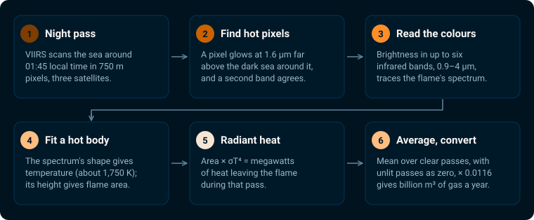

*Figure 1. The six steps. Each is explained below.*

### Three satellites, one look each per night

The VIIRS instrument flies on three US weather satellites: Suomi NPP,
NOAA-20 and NOAA-21. They share one orbit, pole to pole, and cross any given
place at about the same local time: around 01:45 at night, with most passes
between 00:50 and 02:50. Each sweep covers a strip of the Earth about 3,000 km
wide, so every offshore field is seen at least once a night by each satellite.

The infrared pixels used here measure 750 m on a side directly below the
satellite (nadir) and grow to about 1.6 km at the edges of the sweep.

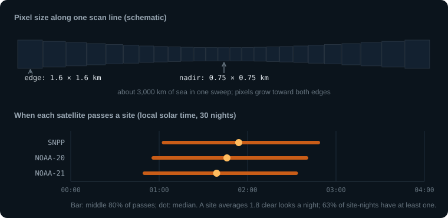

*Figure 2. Pixels grow toward the edges of each sweep (top). All three
satellites pass a site within the same two hours of the night (bottom).*

Clouds block the view. Over these 30 nights a site averaged 1.8 clear looks a
night, and 63% of site-nights had at least one clear pass.

### A flare is far smaller than a pixel

A gas flare is a flame a few metres across at the end of a boom. The median
flare detected here has about 2 m² of flame, which fills about 1/270,000 of a
nadir pixel. The satellite cannot see the flame's shape. It records how much
extra light the whole pixel gives off, and everything else is worked back from
that.

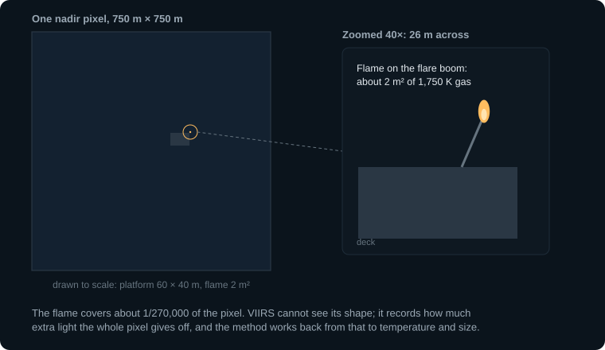

*Figure 3. A flare and its platform inside one pixel, to scale.*

### Why night, and why infrared

Every object glows with a spectrum set by its temperature. The night sea, at
about 290 K (17 °C), glows in the thermal infrared around 10 µm. A flare, at
about 1,750 K, glows most strongly in the short-wave infrared around 1.6 µm.
At 1.6 µm the flare outshines the sea by about 500,000 to 1, even though the
flame fills a tiny part of the pixel. In daylight, reflected sunlight would
swamp that signal, so the method works only at night.

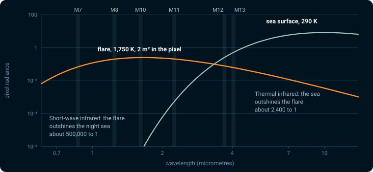

*Figure 4. Light reaching the satellite from one pixel, split into the flare's
share and the sea's share. Shaded bars mark the six VIIRS bands used (M7 to
M13).*

### Finding the flare

In each satellite image the pipeline measures the typical brightness of the
dark sea in the 1.6 µm band (called M10) and its spread. A pixel brighter than
the average by four times the spread is a candidate. It is confirmed only when
at least one other band also shows heat; a single-band spike is usually a
particle hitting the detector.

Hot pixels that touch form a patch. A big flare also lights up its
neighbouring pixels (glow), so only the brightest pixel of a patch counts as
the flare's location.

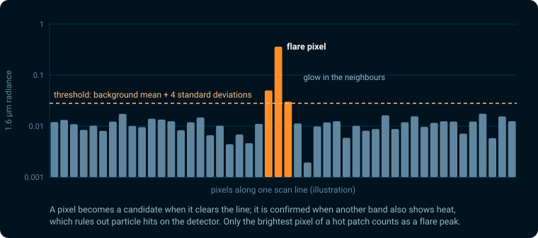

*Figure 5. One scan line through a flare (illustration with typical values).*

### Reading temperature and size from the colours

A hot body's spectrum has a fixed shape for each temperature: hotter flames
peak at shorter wavelengths. The pipeline compares the brightness in up to six
bands with these shapes (Planck curves) and finds the one that fits. Two
numbers come out:

- **Temperature**, from where the curve peaks. Detected flares have a median
  of 1,751 K (5th to 95th percentile 1,496 to 2,113 K).
- **How much of the pixel the flame fills**, from the curve's height. Times
  the pixel's area, this is the flame's area in square metres.

A band that disagrees strongly with the others is set aside and the fit
repeated.

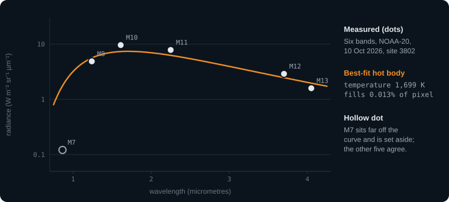

*Figure 6. A real measurement: NOAA-20 over site 3802 on 10 October 2026. Five
bands agree on a 1,699 K flame; M7 is set aside.*

### Radiant heat

Temperature and area give the heat the flame radiates, by the
Stefan–Boltzmann law: heat = area × σ × temperature⁴. The result is in
megawatts (MW). The median detection is 1.16 MW, and 95% are below 24 MW.

A flare that spills into neighbouring pixels gets their heat added, counting
only neighbours that read at least 75% of the peak pixel. EOG calls this value
RH75%.

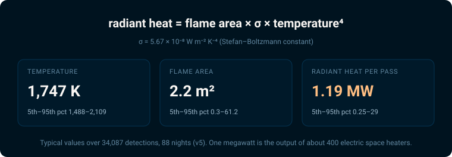

*Figure 7. The radiant-heat formula and typical values over 11,527
detections.*

### One flare, recorded once, at one site

Two effects can make one flare look like two.

**Bow-tie copies.** VIIRS sweeps 16 rows of detectors at a time. Toward the
edges of the swath each sweep widens and overlaps the next, so a flare can be
recorded twice, about a pixel apart, in consecutive sweeps. The pipeline pairs
such copies and averages them into one measurement.

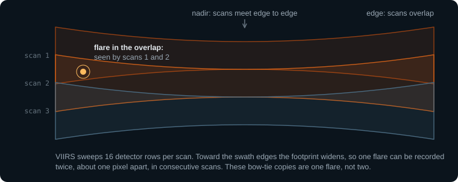

*Figure 8. Consecutive scans overlap toward the edges of the swath.*

**Neighbouring platforms.** Half of the sites (3,858 of 7,637) have another
site within 2 km, while an edge pixel is 1.6 km wide. A flare's glow can light
the pixel over a neighbour. The pipeline treats a hot patch as one source and
assigns it to the site nearest its centre, within 2 km.

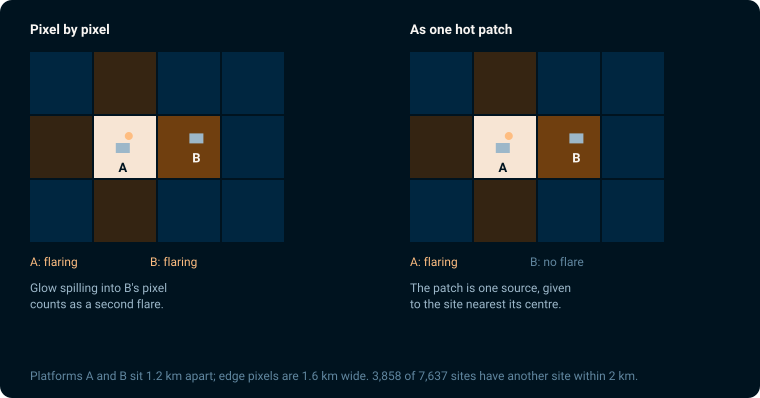

*Figure 9. The same hot patch, counted pixel by pixel (left) and as one
source (right).*

### From passes to nights to a yearly rate

Each satellite pass over a site gives one of four outcomes:

- **Flare seen, clear sky**: a radiant heat value.
- **Clear sky, no flare seen**: counts as zero. A flare that is off, or too
  small to detect, contributes nothing.
- **Flare seen through cloud**: proof the flare was lit, but the cloud dims
  it, so the value is not used for volume. The app shows these nights as
  "lit under cloud".
- **Cloudy, nothing seen**: unknown. It is left out entirely, not counted as
  zero.

A night's value is the mean over its clear passes. A longer period's value is
the mean over nights that had a clear pass.

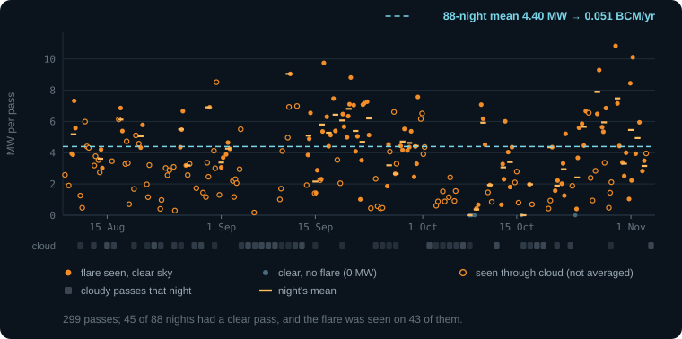

*Figure 10. Every pass over site 928 (Bay of Campeche, Mexico) for 30 nights.
Hover a dot in the app to see its value.*

### Converting heat into gas

EOG calibrated radiant heat against gas volume using flares with metered flow:
36 controlled tests at the John Zink flare test facility in Oklahoma (Zhizhin
et al. 2025) and national flaring reports (Elvidge et al. 2016). Their
2025 annual catalog uses:

**gas flared (billion m³ per year) = 0.0116 × mean radiant heat (MW)**

A site averaging 1 MW over the year flares about 11.6 million m³ of gas a
year. The result is an annual rate: what the site would flare in a year if it
kept the average seen over the nights observed.

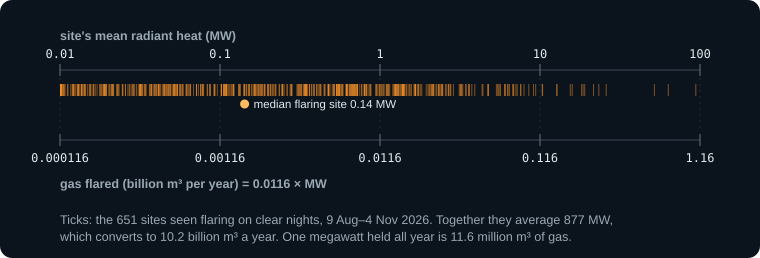

*Figure 11. The conversion scale, with the 492 sites seen flaring on clear
nights. The median flaring site averages 0.29 MW, about 3.4 million m³ a
year.*

### What the numbers can and cannot tell you

**Small flares are missed.** The detection limit depends on the sensor, not
the flare. Detections thin out below about 0.3 MW, and small flares are missed more so at the edge of
the swath where pixels are larger. A site reading "clear, no flare" may still
have a small flame.

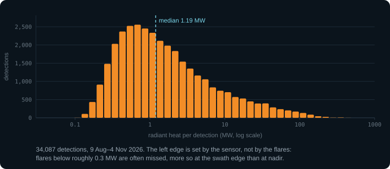

*Figure 12. Radiant heat of every detection. The drop below about 0.3 MW comes
from the sensor's limit.*

**One pass is a sample.** Flames flicker and wind bends them, and the
satellites see a site minutes apart from different angles. When two
satellites both saw the same flare on the same clear night, 30% of the pairs
differed by more than a factor of two (n = 1,598 site-nights). Averages over
weeks are much steadier than any single night.

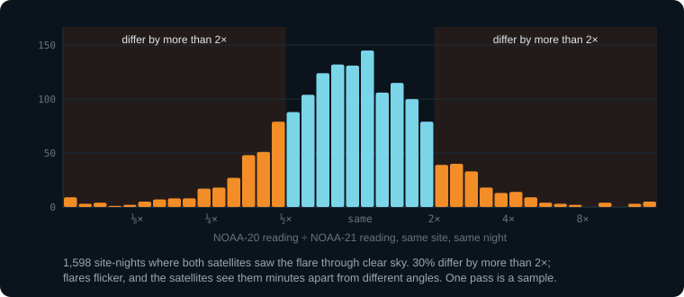

*Figure 13. NOAA-20 against NOAA-21 for the same site and night.*

**Viewing angle changes the reading.** Flames are taller than they are wide,
so a satellite looking from the side sees more flame than one looking
straight down. Passes near the swath edge read 1.53 times the nadir passes at
the same flares (median of 42 persistent flares). EOG's calibration does not
correct for this, and neither does this pipeline; it averages out over many
passes.

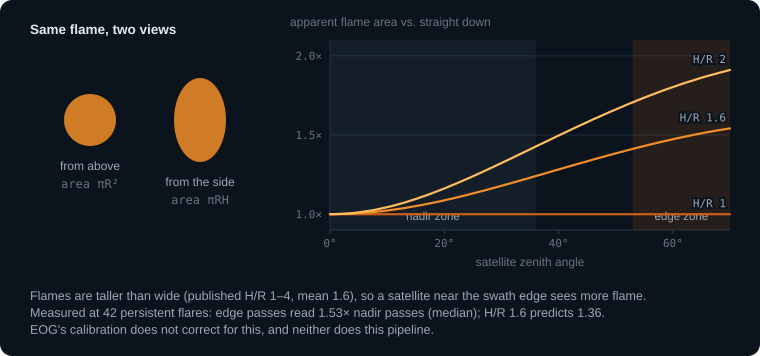

*Figure 14. Apparent flame area against viewing angle, for flames 1, 1.6 and 2
times taller than wide (Elvidge et al. 2016).*

**Clouds hide flares.** Cloudy passes are left out, so a site under cloud for
a week has no value for that week. Thin cloud that the cloud mask misses can
dim a flare without removing it.

**One time of night.** All passes fall between about 00:50 and 02:50 local
time. A flare that runs only by day, or changes through the day, is sampled
at that hour only.

**Nearby platforms are hard to tell apart.** Where two GFW sites sit within
2 km of one known flare, the flare is assigned to one site on some passes and
the other on other passes in 52% of cases (92 of 178 such flares). Totals over
an area are more reliable than the split between neighbouring platforms.

**Not every flare is from oil production.** The site list is GFW's offshore
oil infrastructure. Some sites are processing plants or terminals, which this
pipeline does not yet flag.

**The calibration is an average.** The 0.0116 slope comes from controlled
tests and national totals; the 2025 calibration paper's text gives 0.0124,
7% higher. Individual flares burn gas of different composition and
efficiency.

**Agreement with EOG.** At 363 sites flaring in both this pipeline (30 nights
of 2026) and EOG's 2025 annual catalog, the two agree in order of magnitude
and rank (correlation of the logs r = 0.51) and our values are lower (median
ratio 0.63). The comparison mixes different years, period lengths and site
lists.

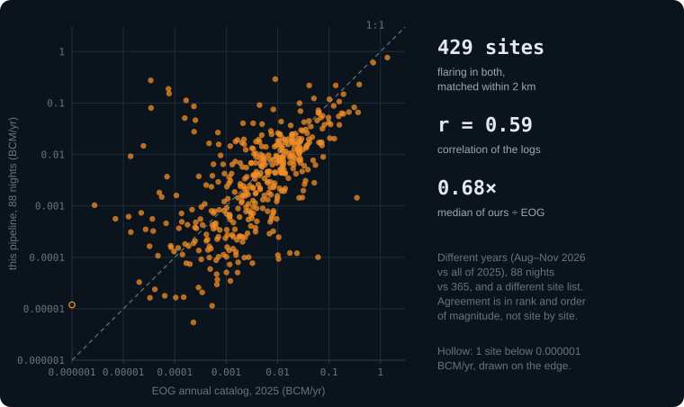

*Figure 15. Each dot is one site, matched to the nearest EOG flare within
2 km.*

**The record starts in August 2026.** The free NOAA data bucket keeps about 91
days. Earlier years exist in NASA's archive, which uses a different file
format and calibration and is not yet read by this pipeline.

### Reading the app

- **Map colour** is the site's mean radiant heat over the selected nights.
  Gas volume in the side panel uses the 0.0116 conversion.
- **A single night** is a sample of one to three passes. Use ranges of a week
  or more to compare sites.
- **"Lit under cloud"** means the flare was seen through cloud. It shows the
  flare was burning but carries no volume.
- **Regional totals** are steadier than the split between neighbouring
  platforms.

---

## Part 2. What this implementation changes

EOG describes VIIRS Nightfire across nine papers from 2013 to 2026 but has not
released its code, and several settings are not published. This pipeline
rebuilds the method from the papers. The changes fall into five groups:
scope, simplifications, settings the papers leave open, corrections added
here, and reliability work that does not change values.

Each version was reviewed by two independent AI models (GPT-6.1 Sol and Claude
Opus 5.5) against the papers and the run outputs; five reviews so far.
Every choice, with its evidence, is in the
[decision log](decisions.md) (entries D01 to D50), and every review finding is
in the [review record](reviews.md).

### Net effect of the corrections

The corrections in group D below were made between pipeline v3 and v5. Over
the same 30 nights they cut detected radiant heat by 20%, while the number of
detections fell by only 1.4% (11,695 to 11,527). The summed site means fell
from 944 to 759 MW, or from 10.95 to 8.80 billion m³ a year. 81% of the drop
removes errors in v3's handling.

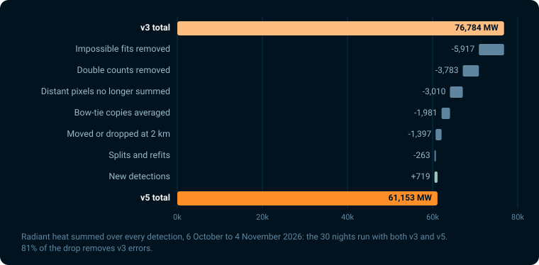

*Figure 16. Radiant heat summed over all detections, v3 to v5, by cause.*

### A. Scope: where and when we look

**Only GFW offshore oil sites.** EOG detects flares anywhere and builds its
own catalog of flare sites. This pipeline looks only within 2 km of Global
Fishing Watch's offshore oil infrastructure: 11,342 active structures, merged
into 7,637 sites where they sit within 750 m of each other (about one pixel).
*Why:* the goal is a value per platform. *Effect on interpretation:* a flare
more than 2 km from any listed structure is not counted, and totals cover
GFW-listed infrastructure only. 126 of our flaring sites have no EOG flare
within 2 km.

**Nightly values from NOAA's free bucket.** EOG publishes annual values
openly and licenses nightly ones. This pipeline reads the same raw satellite
files (NOAA's operational sensor data records) from NOAA's free public
bucket. *Effect:* nightly values with no licence, but only for the last 91
days; history needs another data source.

**Only the images that contain a site.** NASA's catalog of image outlines
selects the roughly 150 of 500 night images per satellite that contain a
site. *Effect:* none on values; it cuts download time about threefold.

### B. Simplifications

These published steps are not reproduced:

| EOG step | Here | Effect on interpretation |
| --- | --- | --- |
| Spectral response of each band | Planck curve evaluated at the band centre | A few percent of model error (decision D12), covered by the 10% allowance in group C |
| Two-curve fit (flame plus warm background) | One flame curve; mid-infrared bands have the local background subtracted first | Not compared directly |
| Triggers from M11 and from the mid-infrared bands | Detection starts from M10 only | The faintest and coolest flares are missed: 21% (74 of 356) of EOG's persistent flares had no clear-night detection in 30 nights |
| Atmospheric correction (VIIRS Nightfire v4) | None | Matches the v3 top-of-atmosphere values the 0.0116 slope was calibrated on |
| Cross-calibration between satellites | None | Satellite differences enter the average unadjusted: NOAA-20 reads 0.93 times NOAA-21 at the same flares (median, n = 1,598) |
| Day/Night Band, for flares seen only at 1.6 µm | Not used; a candidate needs a second infrared band | Such single-band candidates are dropped: 1 of 93 candidates near sites in a five-image check |

### C. Settings the papers leave open

The papers describe these steps without a number. Each value here is a choice,
recorded with its reasons:

| Setting | Choice | Why |
| --- | --- | --- |
| How the fit weighs each band | By each band's measured noise, plus a 10% allowance for model error | Without the allowance, every flare above 20 MW failed the fit test on model error alone and lost bands |
| Glow test neighbourhood | Peak must be the brightest pixel within 2 pixels in its scan | The papers give no size |
| Small isolated clouds over a flare | Cleared when 6 of the 8 surrounding pixels are clear | EOG clears isolated clouds over flares but gives no size |
| Which neighbours join RH75% | The 8 pixels touching the peak in its scan, between 0.75 and 1.5 times the peak | The papers say "adjacent pixels" without a stencil or cap |
| Repeated records of one site | Same satellite, under 10 s apart: one observation | Neighbouring images overlap by a few seconds |
| Background statistics | Per image and per pixel-size zone, with one clipping pass | The papers' screen is in raw sensor counts; these files hold calibrated radiance |

### D. Corrections and safeguards added here

**1. The site's pixel must hold a measurement.** Where bow-tie copies overlap,
NOAA blanks the duplicate pixels but keeps their positions. The first version
of this pipeline read such blanks as "clear sky, no flare" at 11% of site
passes (21,205 of 189,764). The pipeline now uses the nearest pixel with a
real measurement. *Effect:* removes false zeros that pulled site means down.

**2. One flare, one site.** Reading pixel by pixel, the first version counted a
large flare's glow as a second flare at the neighbouring platform: 12.7% of
detections (501 of 3,935). The pipeline now groups hot pixels into one
source, applies the glow test, and assigns the source to one site by its
centre. *Effect:* glow detections fell below 1%. From v3 to v5 the
source-centre assignment removed a further 3,783 MW of double counting, and
same-pass detections at two sites under 2 km apart fell from 196 to 72 pairs
(Figure 9).

**3. Physical limits on the temperature fit.** A fit that uses only the two
shortest bands (M7 and M8) can match them with a cool, very large "flame",
which inflates radiant heat many times over. The pipeline now requires at
least two of the four flare bands (M10 to M13), including M10 or M11, and a
temperature of 1,200 to 3,500 K (two-band fits 1,200 to 2,500 K). A good fit
that breaks a limit is replaced by a standard 1,810 K estimate from M10,
instead of dropping bands until the limit passes. *Effect:* removed
5,917 MW (7.7% of v3's detected heat) from 330 detections. At site 3802 one
pass fell from 3,127 MW to 115 MW. Fits replaced by the standard estimate are
3.2% of detections and 0.4% of radiant heat.

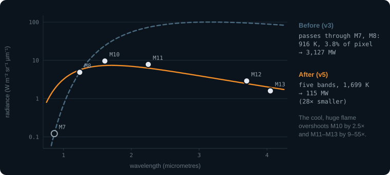

*Figure 17. Site 3802: the v3 fit (dashed) matches M7 and M8 but overshoots
every other band; the corrected fit (solid) matches five bands.*

**4. Radiant heat anchored on the flare's peak.** EOG's RH75% adds pixels
above 75% of the patch's highest-heat pixel. One badly fitted pixel can then
set the whole value. The pipeline anchors on the brightest 1.6 µm pixel,
which locates the flare, and adds only its touching neighbours. *Effect:*
removed 3,010 MW over 200 detections; site 3804 on 3 November fell from
1,776 MW to 71 MW.

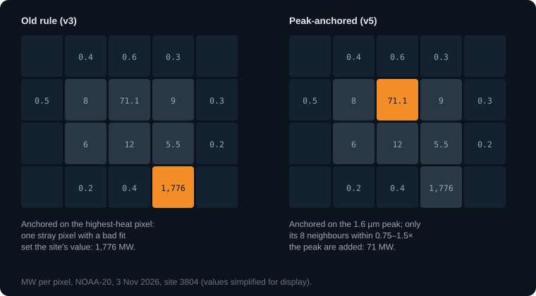

*Figure 18. The same hot patch under the old and new rule.*

**5. Bow-tie copies matched and averaged.** EOG drops copies closer than half
a pixel and keeps one. Here, 59% of matched copies (756 of 1,271) sit more
than half a pixel apart, so the half-pixel rule would count them as second
flares. The pipeline pairs copies in consecutive sweeps up to 1.5 pixels
apart, in the same column (±1), within a factor of 3 in heat, one copy per
sweep; averages their heat; and places the flare at their heat-weighted
centre. *Effect:* 1,271 copy pairs merged over 30 nights. Averaging gives
1,981 MW less than keeping the stronger copy; keeping the stronger copy, as
EOG does, would make the v3-to-v5 change −18.0% instead of −19.9%. Read our
totals as about 3% below an EOG-style count.

**6. Two flares in one hot patch.** Flares on one platform can merge into one
hot patch. The pipeline splits a patch at a second brightness peak only when
the brightness between the two peaks drops below half of the smaller peak.
*Effect:* 0.75% of detections (87 of 11,527) come from split patches. Of the
75 detections new in v5, 8 of the 10 largest come from split patches.

**7. Clear-sky rule kept strict.** The first version counted every detection
as clear sky. 30% of its detections were under cloud flags, carrying 18% of
the heat. The pipeline now uses only clear passes for volume and shows
cloud-covered detections as "lit under cloud". *Effect:* volumes are
clear-sky averages; the on/off record still uses the cloudy detections.

**8. Detections kept when images overlap.** When a site appears in two
consecutive images seconds apart, the pipeline keeps the record with a
detection, if either has one. *Effect:* 0 detections lost in 30 nights.

**9. Viewing angle measured, not corrected.** Section "Viewing angle" above.
Edge passes read 1.53 times nadir passes (n = 42 flares). Elvidge et al. 2016
corrected flame area to a side view; the operational calibration and this
pipeline do not. *Effect:* single-night values depend on which satellite
looked from where; averages over many passes mix geometries the same way
EOG's do.

**10. Like-for-like comparison with EOG.** EOG reports how often a flare is
detected per clear pass. Measured the way EOG counts, detections per clear
pass at persistent flares are 0.39 here (strict clear sky, n = 356) or 0.51
(counting a detection as proof of clear sky), against EOG's 0.63. *Effect:*
the published per-site rate (0.27 in v3) understated detection. Review 2
split v3's gap into roughly equal parts: cloud handling, attribution among
nearby sites, and small flares plus real change between 2025 and 2026.

### E. Reliability and audit trail

These changes do not alter values:

- **Copy table.** Every confirmed flare copy is saved with its position, fit,
  cloud flag, pairing and site, so attribution can be re-checked without
  downloading the images again.
- **Restartable runs.** Each image's results are written atomically and a
  manifest lists every expected image, so an interrupted run resumes where it
  stopped and missing images are listed.
- **Oldest images first.** NOAA deletes the oldest nights first, so long runs
  process them first.
- **Retries and caching** for NASA's catalog, which took up to 84 s per query
  during the 30-night run.
- **Gate checks.** A script tests every run against eleven acceptance gates
  (coverage, fit limits, copy pairing, attribution, totals and comparison with
  EOG) before a backfill.

---

## Sources

- Elvidge et al. 2013, *Remote Sensing* 5:4423: detection, Planck fit,
  radiant heat.
- Elvidge et al. 2016, *Energies* 9:14: first volume calibration; flame shape
  and viewing angle.
- Elvidge et al. 2019, *Remote Sensing* 11:395: M11, mid-infrared detection,
  band elimination.
- Zhizhin et al. 2021, *Remote Sensing* 13:3078: cloud handling, calibration.
- Elvidge et al. 2021, *Fire* 4:83: VIIRS Nightfire v4.
- Zhizhin et al. 2025, *Energies* 18:4765: John Zink calibration, RH75%.
- Zhizhin et al. 2026, *Remote Sensing* 18:314: the 2025 annual catalog
  (MYC25Q4, CC BY-NC 4.0).
- Global Fishing Watch, offshore fixed infrastructure.
- NOAA Open Data Dissemination: VIIRS sensor data records and cloud mask.

Figures are generated by [`explainer/make_figures.py`](explainer/make_figures.py)
from the run outputs.
